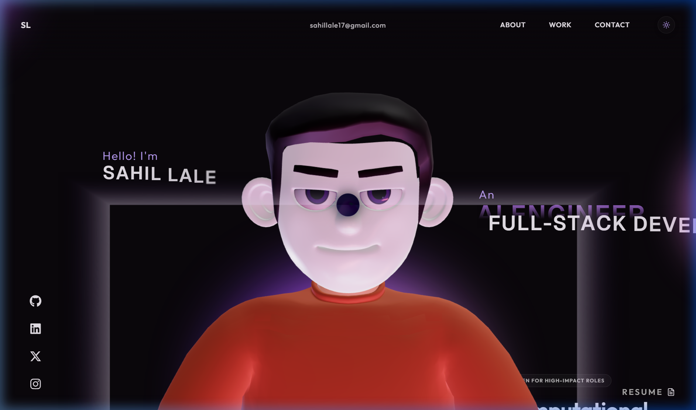
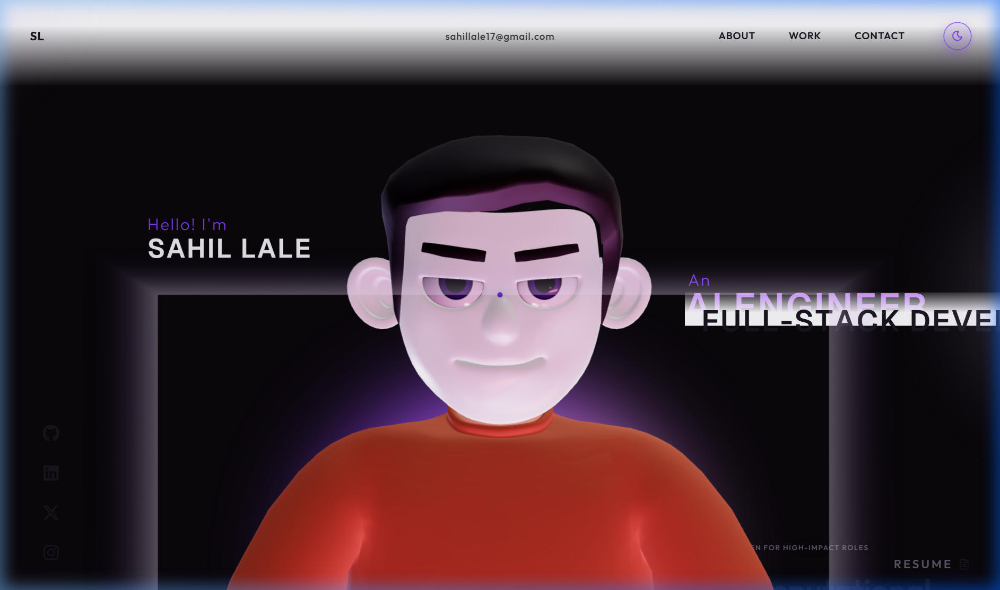
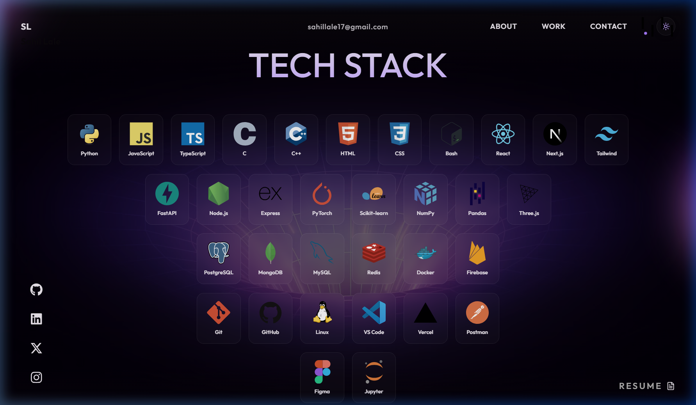
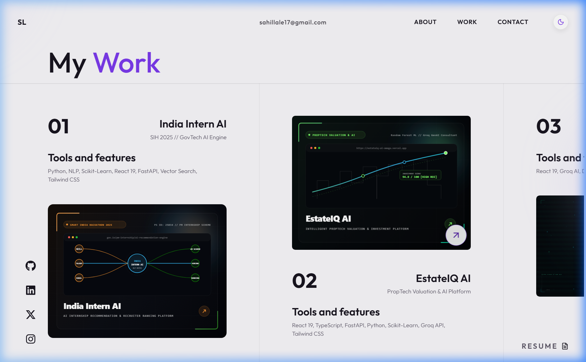
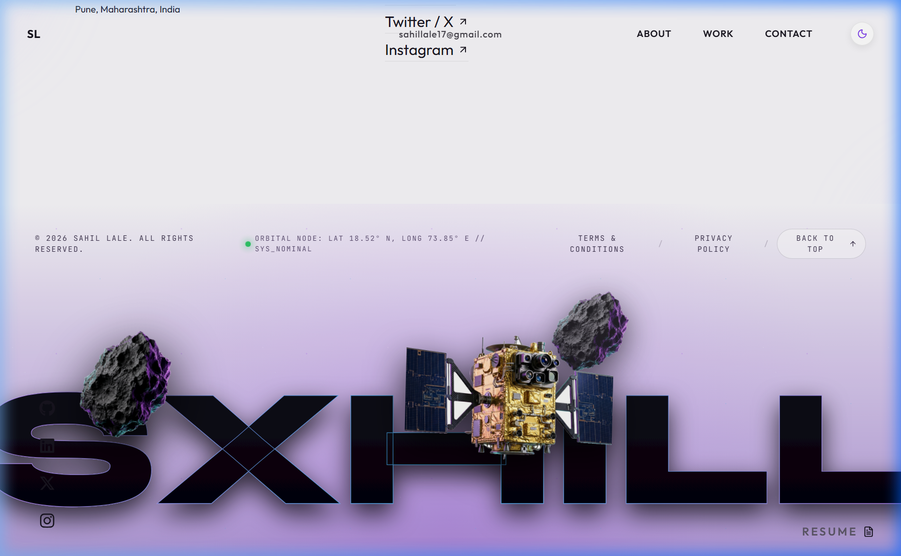

# Sahil Lale -- AI & Full-Stack Engineer Portfolio

[](https://sahil-tech.netlify.app/)
[](https://github.com/sahil-exe-17)
[](https://react.dev/)
[](https://threejs.org/)
[](https://vitejs.dev/)

A modern, high-performance developer portfolio showcasing production AI applications, machine learning systems, and full-stack architectures. Built with reactive UI states, Three.js 3D character interactions, dual theme persistence, and zero-latency desktop and mobile responsiveness.

---

## Live Deployment

Experience the production deployment: [https://sahil-tech.netlify.app/](https://sahil-tech.netlify.app/)

---

## Visual Showcase

### Desktop Interactive 3D Hero (Dark Mode)


### Porcelain Theme Alternative (Light Mode)


### High-Impact Tech Stack Grid


### Production Projects Architecture


### Monumental SXHILL Orbital Space Footer


---

## Core Architecture & Features

### 1. Dual Theme System (Dark & Light)
- Architecture: Custom React Context API (`ThemeProvider`) with persistent state synchronization via `localStorage`.
- Palette: 
  - Dark Theme: Deep obsidian (#060608), rich cosmic violet, and luminous aurora accents.
  - Light Theme: Frosted porcelain (#f8f7fa), deep slate contrast typography (#18151f), and vivid violet accents (#7c3aed).
- CSS Variables: Fully tokenized design system (`--backgroundColor`, `--textColor`, `--cardBg`, `--cardBorder`, `--navBg`).

### 2. High-Performance Three.js 3D Character
- Realistic 3D model with continuous breathing, blink cycles, and look-at cursor tracking.
- Automated GPU Culling: Rendering halts automatically when scrolled past the viewport threshold (`window.scrollY > 2000`) to preserve GPU resources for subsequent sections.
- Adaptive Resolution: Dynamic device pixel ratio clamping (1.4 max) prevents frame drops on Retina and 4K displays.

### 3. Monumental Zero-G Orbital Footer (SXHILL)
- Display Typography: Scalable, edge-to-edge monumental lettering rendered in SVG with titanium metallic fill gradient and aurora rim light.
- Multi-Plane Space Scene:
  - High-resolution orbital satellite probe with solar panels and gold foil drifting across the typography.
  - Floating asteroid boulders tumbling in zero gravity.
  - Ambient nebula glow and stardust particle field.
  - Interactive mouse parallax on desktop screens.
- Monospace Command Deck: Real-time orbital coordinates, accessible Terms & Privacy modal dialogs, and smooth glide-to-top control.

### 4. Enlarged Tech Stack Visualizer
- 30+ categorized technologies arranged in an inverted pyramid configuration.
- High-visibility cards with 48px icons, frosted glass backdrop filters, and spring hover animations.
- Responsive reflow: Adapts from 120px cards on 4K monitors to 66px touch-friendly badges on mobile devices.

### 5. Production Project Showcase (17 Deployed Systems)
- Every project features authentic, custom-designed artwork and deployed application screenshots (zero generic stock placeholders).
- Horizontal scrub gallery with GSAP ScrollTrigger on desktop, transitioning smoothly into a native touch carousel on mobile.
- Dedicated standalone catalog page (`/myworks`) displaying full project overviews with technology tags and external repository links.

---

## Technology Stack

| Domain | Technologies |
| :--- | :--- |
| Frontend Core | React 19, Vite 8, JavaScript (ESNext), HTML5 Semantic Architecture |
| Styling & Theming | Tokenized CSS3 Variables, Tailwind CSS, Frosted Glassmorphism |
| 3D & Graphics | Three.js, Draco GLTF Compression, Custom Canvas Shaders |
| Animation & Motion | GSAP 3, ScrollTrigger, Lenis Smooth Scroll |
| Icons & Visuals | Lucide React, Devicons Vector Library |
| Deployment | Netlify CDN, Automated SPA Redirects (`netlify.toml`) |

---

## Clean Repository Directory Layout

```text
Portfolio/
|-- public/
|   |-- images/
|   |   |-- readme/            # Visual previews for documentation
|   |   |-- footer_satellite.png
|   |   |-- footer_asteroid.png
|   |   `-- mypicnbg.png       # Profile asset
|   |-- models/                # 3D GLTF models and Draco mesh decoders
|   |-- projects/              # Authentic custom project graphics & screenshots
|   |-- favicon.png            # Cat brand favicon (512x512)
|   |-- favicon.ico            # Multi-size ICO
|   |-- favicon.svg            # Scalable brand vector icon
|   |-- apple-touch-icon.png   # iOS touch icon
|   `-- video/                 # Ambient background videos
|-- src/
|   |-- components/
|   |   |-- AboutSection.jsx   # Bento grid profile overview
|   |   |-- CareerSection.jsx  # Interactive career & milestone timeline
|   |   |-- Character3D.jsx    # Optimized Three.js 3D character engine
|   |   |-- ContactSection.jsx # Direct contact channels & social hubs
|   |   |-- CtaSection.jsx     # Call to action and availability badge
|   |   |-- Hero.jsx           # Editorial hero with animated typography
|   |   |-- LoadingScreen.jsx  # Interactive launch preloader
|   |   |-- MainPortfolio.jsx  # Main connected scroll pipeline
|   |   |-- MonumentalFooter.jsx # Orbital space footer with SXHILL typography
|   |   |-- MyWorksPage.jsx    # Complete 17-project standalone portfolio grid
|   |   |-- Navbar.jsx         # Frosted glass nav with Dark/Light toggle
|   |   |-- SocialDock.jsx     # Hardware-accelerated floating social links
|   |   |-- TechStackSection.jsx # Enlarged tech stack badge visualization
|   |   |-- WhatIDo.jsx        # Specialization cards (AI/ML & Architecture)
|   |   `-- WorkSection.jsx    # Pinned horizontal project showcase
|   |-- context/
|   |   `-- ThemeContext.jsx   # Dark / Light theme provider & storage hook
|   |-- styles/
|   |   `-- portfolio.css      # Core tokenized stylesheet
|   |-- utils/
|   |   |-- dailyDrip.js       # Character outfit and texture configurations
|   |   |-- initialFX.js       # Audio and visual preloader effects
|   |   `-- splitText.js       # Typography splitting helper
|   |-- App.jsx                # Route declarations and root providers
|   |-- config.js              # Centralized portfolio data (17 real projects)
|   |-- index.css              # Global baseline and font imports
|   `-- main.jsx               # Application mount entrypoint
|-- index.html                 # Root document template with favicon headers
|-- netlify.toml               # Continuous deployment and SPA route rules
|-- package.json               # Dependencies and build scripts
`-- vite.config.js             # Vite configuration and asset optimizations
```

---

## Local Development

### Prerequisites
- Node.js (v18.0.0 or higher)
- npm or yarn

### Installation
1. Clone the repository:
   ```bash
   git clone https://github.com/sahil-exe-17/Portfolio.git
   cd Portfolio
   ```

2. Install dependencies:
   ```bash
   npm install
   ```

3. Launch development server:
   ```bash
   npm run dev
   ```
   Open `http://localhost:5173` in your browser.

4. Build production bundle:
   ```bash
   npm run build
   ```

---

## Production Deployment to Netlify

The repository is pre-configured with `netlify.toml` for continuous deployment:

```toml
[build]
  publish = "dist"
  command = "npm run build"

[[redirects]]
  from = "/*"
  to = "/index.html"
  status = 200
```

To deploy via Netlify CLI:
```bash
npx netlify deploy --prod --dir=dist
```

---

## Contact & Profile

- Portfolio: [https://sahil-tech.netlify.app/](https://sahil-tech.netlify.app/)
- GitHub: [https://github.com/sahil-exe-17](https://github.com/sahil-exe-17)
- LinkedIn: [https://linkedin.com/in/sahil-lale-199072355](https://linkedin.com/in/sahil-lale-199072355)
- Email: sahillale17@gmail.com
- Location: Pune, Maharashtra, India

---

## License

This project is open-source under the MIT License. Developed by Sahil Lale.
